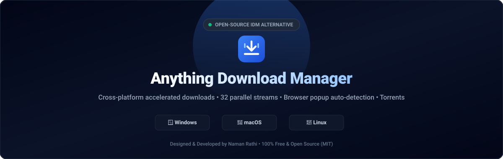
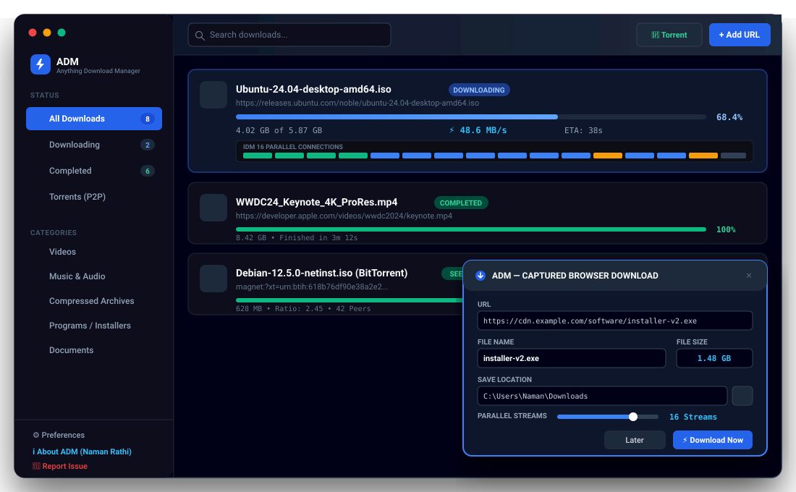

# ⚡ Anything Download Manager (ADM)

<p align="center">
  
</p>

<p align="center">
  <a href="https://github.com/namanrathi07/anything-download-manager/releases"></a>
  <a href="https://opensource.org/licenses/MIT"></a>
  <a href="#platform-support"></a>
  <a href="https://namanrathi07.github.io/anything-download-manager"></a>
</p>

---

## 📖 Overview

**Anything Download Manager (ADM)** is a high-performance, open-source download manager created by **Naman Rathi** to serve as a modern, cross-platform alternative to Internet Download Manager (IDM).

Unlike proprietary download tools limited to Windows or locked behind paid trials, ADM is **100% free and open-source forever**, runs natively on **Windows, macOS, and Linux**, accelerates downloads with up to **32 parallel streams**, integrates with all major web browsers with an instant IDM-style download popup, and includes native **BitTorrent / Magnet link** downloading.

---

## 📸 Aesthetic UI Showcase

<p align="center">
  
</p>

*Dark mode user interface featuring live parallel chunk visualizer, connection throughput metrics, and instant browser interception popup.*

---

## 🌟 Key Features

| Feature | Anything Download Manager (ADM) | Internet Download Manager (IDM) | Standard Browser Downloader |
|---|---|---|---|
| **Price & License** | **100% Free & Open Source (MIT)** | $24.95/yr (Proprietary trial) | Free |
| **Operating Systems** | **Windows, macOS & Linux** | Windows Only | Windows, macOS, Linux |
| **Multi-Stream Speed** | **Up to 32 parallel connections** | Up to 32 parallel connections | 1 single stream |
| **Browser Auto-Detection** | **Instant Popup on all browsers** | Yes (Windows only) | Standard bottom shelf |
| **Supported Browsers** | **Chrome, Firefox, Edge, Brave, Opera, Vivaldi** | Chrome, Edge, Firefox | Browser only |
| **BitTorrent / Magnet** | **Built-in WebTorrent Client** | ❌ No (HTTP/FTP only) | ❌ No |
| **Streaming Video Sniffer**| **On-screen HTML5 player overlay** | Yes | ❌ No |
| **User Interface** | **Modern React 19 + Tailwind Dark UI** | Windows 98/XP legacy skin | Minimal browser UI |
| **Persistence** | **Embedded SQLite + JSON Fallback** | Registry keys | SQLite history |

---

## 🚀 Architectural Highlights

- **Multi-Stream HTTP Range Engine**: Partitions remote files into dynamically balanced chunks downloaded simultaneously via HTTP `Range: bytes=X-Y` requests.
- **Fail-Safe Dependency Packaging**:
  - Resilient, zero-native cross-platform persistence store (`adm_data.json`) eliminating any missing `.dll` or Visual C++ runtime (`vcruntime140.dll`) errors on Windows.
  - Multi-arch installers for Windows (`x64`), macOS (Apple Silicon `arm64` & Intel Universal `x64`), and Linux (`AppImage`, `deb`).
- **Universal WebExtension (Manifest V3)**:
  - Hooks `chrome.downloads` to cancel native downloads and forward the request to ADM.
  - Injects hover action pills over download links (`.zip`, `.iso`, `.exe`, `.mp4`).
  - Scans for HTML5 `<video>` and `<audio>` streams and displays an on-player download button.
  - Communicates via local WebSocket at `ws://127.0.0.1:28370` and native messaging stdio host.
- **In-App Issue Reporter**: End-users can submit bug reports, download issues, or feature ideas directly to GitHub through the app with auto-collected system diagnostics.

---

## 🛠️ Quick Start & Development

### 1. Prerequisites
- [Node.js](https://nodejs.org/) v18+ (tested on Node v20 & v24)
- npm or yarn

### 2. Install & Run Locally
```bash
# Clone the repository
git clone https://github.com/namanrathi07/anything-download-manager.git
cd anything-download-manager

# Install dependencies (auto-builds native bindings)
npm install

# Start development server
npm run dev

# Launch Electron application
npm start
```

---

## 🌐 Browser Extension Setup

1. Open your browser's extension manager:
   - **Chrome / Brave**: `chrome://extensions`
   - **Microsoft Edge**: `edge://extensions`
   - **Firefox**: `about:debugging#/runtime/this-firefox`
2. Enable **Developer mode** (toggle in the top-right corner).
3. Click **Load unpacked** (or "Load Temporary Add-on" in Firefox).
4. Select the [`browser-extension`](browser-extension/) directory in this repo.
5. The extension will automatically link to ADM's background service on `127.0.0.1:28370`.

---

## 📦 Building Standalone Installers

ADM uses `electron-builder` with pre-configured multi-OS bundles:

```bash
# Package for your current operating system
npm run dist

# Package for Windows (.exe setup & portable)
npm run dist:win

# Package for macOS (.dmg Apple Silicon & Intel)
npm run dist:mac

# Package for Linux (.AppImage, .deb, .rpm)
npm run dist:linux
```

All installers will be generated in the `release/` folder.

---

## 🐞 Reporting Issues & Contributing

We welcome feedback, suggestions, and contributions!
- **In-App**: Click **"Report Issue"** in the sidebar to auto-generate diagnostic details and open a GitHub issue.
- **GitHub**: Visit [Issues](https://github.com/namanrathi07/anything-download-manager/issues) to browse known issues or submit a report.

---

## 👨‍💻 Creator & Maintainer

**Naman Rathi**
- GitHub: [@namanrathi07](https://github.com/namanrathi07)
- Project Website: [https://namanrathi07.github.io/anything-download-manager](https://namanrathi07.github.io/anything-download-manager)

---

## 📄 License

This project is open-source under the [MIT License](LICENSE).
